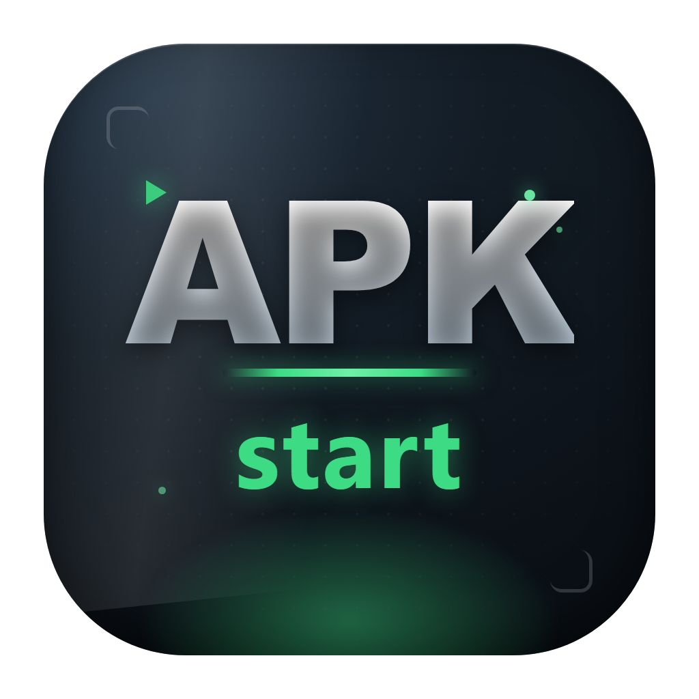
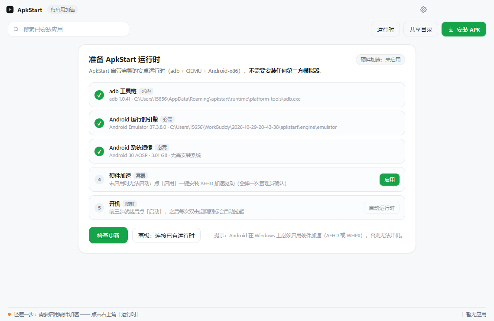
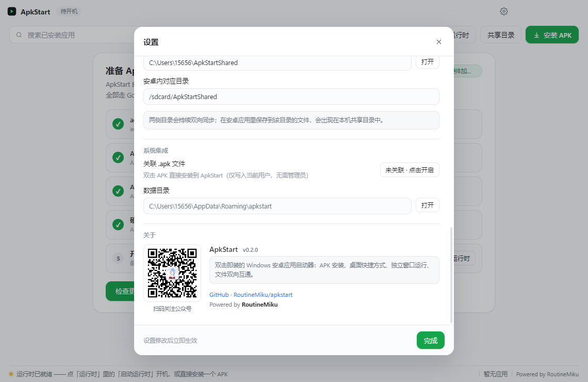

# ApkStart

> **Перевод на русский язык.** Это неофициальный перевод README оригинального проекта [RoutineMiku/apkstart](https://github.com/RoutineMiku/apkstart). Оригинальный текст и права принадлежат автору RoutineMiku. При расхождениях верным считается оригинал.

<p align="center"></p>

[](https://github.com/NaSH-SLOH/apkstart-ru/actions/workflows/ci.yml)
[](LICENSE)
[](#)

**Среда запуска Android-приложений на Windows — Android-приложения устанавливаются и используются так же, как нативные программы Windows.**
Примечание: проект ранний, сделан автором для собственного удовольствия, все правки вносятся после работы и в выходные дни, проект открытый и бесплатный, без вставленной рекламы, пока не очень удобный, рекламными каналами не продвигался — так что внезапные напасти незаслуженны.

- 🖱️ **Двойной клик по .apk — и установка**: после регистрации сопоставления файлов .apk достаточно дважды щёлкнуть APK в проводнике — автоматический разбор → установка → создание значка на рабочем столе, причём интерфейс эмулятора открывать не нужно вообще.
- 🧩 **У каждого приложения свой значок на рабочем столе**: значок извлекается из APK офлайн и конвертируется в многоразмерный ICO; двойной клик по значку = прямой запуск приложения, ощущения те же, что от запуска нативной программы Windows.
- 🪟 **Приложение — это окно**: среда выполнения запускается в режиме **с окном** (в безголовом режиме Android не выдаёт VSYNC, процесс приложения жив, но на экране пусто). ApkStart меняет заголовок этого окна, подставляет настоящий значок приложения, выставляет позицию по пропорциям портретной ориентации — и получается отдельное окно приложения; **полноэкранный режим** растягивает его на всю высоту экрана с центрированием, **оконный режим** позволяет свободно перетаскивать и масштабировать окно, а размер запоминается для каждого приложения.
- 🔍 **Windows его находит**: при установке сразу создаются ярлыки на рабочем столе и в меню «Пуск» (`Программы\ApkStart\`), поиск в меню «Пуск» по имени приложения ведёт прямо к нему, а панель задач группирует окна по приложениям.
- 📁 **Обмен данными**: `%USERPROFILE%\ApkStartShared` ↔ `/sdcard/ApkStartShared` внутри Android — постоянная двусторонняя синхронизация, файлы, сохранённые Android-приложением, сразу появляются на компьютере.
- 🪶 **Предельная лёгкость**: у самой оболочки нет сторонних зависимостей (даже разбор ZIP / PNG / ICO / AXML написан вручную), среда выполнения поднимается по требованию и освобождается в простое; можно вообще задействовать уже имеющуюся на машине среду выполнения Android — дополнительный расход будет нулевым.


```
┌────────────────────────────────────────────────────────────┐
│  Значок рабочего стола (настоящий значок .lnk)             │
│      │  двойной клик                                       │
│      ▼                                                     │
│  ApkStart.exe --launch <имя пакета>                        │
│      │  среда не запущена? → подъём (Emulator + API34)     │
│      ▼                                                     │
│  запуск через LAUNCHER (не главный Activity в APK)         │
│      │  контроль 18 с: повтор / сброс данных / выдача прав │
│      ▼                                                     │
│  окно эмулятора = окно приложения (свой заголовок и значок)│
└────────────────────────────────────────────────────────────┘
```

## ⚠️ Важно: путь без кириллицы

Приложение **падает при запуске** (код `0x80000003`, окно не появляется),
если путь к папке содержит русские буквы:

- ❌ `C:\Мои программы\ApkStart\ApkStart.exe` — не запустится
- ✅ `C:\Apps\ApkStart\ApkStart.exe` — работает

Это ограничение самого ApkStart: он конвертирует китайские пути в короткие 8.3,
а кириллицу не обрабатывает. Оригинальная версия падает так же.

Устанавливайте в путь только из латиницы, цифр, дефисов и подчёркиваний.

## Скачать и пользоваться (без сборки)

**Это русский перевод.** Готовые файлы берите здесь:

- GitHub: [github.com/NaSH-SLOH/apkstart-ru/releases](https://github.com/NaSH-SLOH/apkstart-ru/releases)

Оригинальная китайская версия (если нужна именно она):

- GitHub: [github.com/RoutineMiku/apkstart/releases](https://github.com/RoutineMiku/apkstart/releases)
- Gitee: [gitee.com/daily-miku/apkstart/releases](https://gitee.com/daily-miku/apkstart/releases) (прямое подключение из Китая быстрее)

> ⚠️ В релизах оригинального репозитория интерфейс **китайский** — там
> непереведённая версия. Готовый файл этого форка лежит в разделе
> [Releases](https://github.com/NaSH-SLOH/apkstart-ru/releases).

Что лежит в релизе этого форка:

| Вариант | Имя файла | Когда выбирать |
|---|---|---|
| Облегчённая портативная версия | `ApkStart-v0.6.2-ru.2-win64-portable.zip` (98 MiB, после распаковки ~227 MB) | Распаковал и работаешь; среду выполнения (~1,4 GB) программа скачает сама при первом запуске |

> ⚠️ **Распаковывайте в путь без кириллицы** — см. раздел выше.

> В сборке этого форка собирается **только облегчённая портативная версия**.
> Установщик `Setup.exe`, полный архив со средой выполнения и пакет MSIX
> собираются из исходников автора и содержат китайский интерфейс.
> Команды сборки: `npm run pack` (облегчённая) / `npm run pack:full` (полная) / `npm run build:msix` (пакет для магазина).
> В `ApkStart.exe` записаны фирменный значок и ресурсы версии, синхронизированные с `package.json`.

### Как достигается заполнение экрана

**Физическая ориентация панели** эмулятора (`hw.lcd.width/height`) — это и есть реальная форма изображения. Когда ориентация панели
не совпадает с объявленной самим приложением `screenOrientation`, Android выдаёт приложению лишь узкую полосу в середине, как в письме-«леттербоксе» —
по бокам добавляется чёрный цвет, и ни изменение размера окна, ни правка `wm size`, ни смена стиля letterbox этого не заполнят (вся эта комбинация
проверена по пунктам, см. комментарии в `src/core/apk.js`).

Поэтому ApkStart **при установке APK офлайн разбирает `AndroidManifest.xml`** и определяет, какая ориентация у приложения естественная — альбомная или
портретная (с весом по Activity запуска; если указано только `sensor` / `fullSensor`, при первом запуске у Android дополнительно запрашивается
фактическое значение), сохраняет результат в `apps.json` и при запуске выбирает панель по нему:

- портретные приложения вроде Хунго дуаньцзюй (红果短剧) → панель 720×1280 в портретной ориентации, прямая, заполненная, density 190 (sw606dp), что попутно даёт планшетную вёрстку;
- альбомные приложения вроде Моду (墨读) → панель 1280×720 в альбомной ориентации, прямая, заполненная.

Среда выполнения перезапускается только в тот единственный раз, когда «ориентация панели не совпадает с ориентацией приложения» (около 40 секунд, в заголовке
окна будет подсказка), дальше приложения той же ориентации открываются за секунду. Кнопка поворота в заголовке окна **запоминает** ориентацию этого
приложения (на другие приложения это не влияет), а в разделе «Настройки → Окно приложения → Ориентация экрана» можно выставить «Принудительно альбомная /
Принудительно портретная».

Вёрстку определяет «логическая плотность»: ширина 720 при 190 dpi даёт ровно **606dp**, что как раз переходит планшетный порог Android в 600dp —
двухколоночная страница сериалов и двухпанельные настройки Хунго дуаньцзюй появляются только при такой плотности (у образа по умолчанию 320 dpi, то есть
всего 360dp — это телефонная вёрстка). Это и есть переключатель «Планшетная вёрстка» в настройках, по умолчанию включён; если выключить — вернётся
телефонная вёрстка.

### Обновление по сети (автоматический выбор более быстрого источника)

«Настройки → **Обновление ПО** → Проверить обновления» или правый клик по значку в трее → «Проверить обновления». Когда новая версия найдена,
достаточно нажать «Обновить сейчас».

- установочная версия скачивает `ApkStart-v*-Setup.exe` и ставится в тихом режиме;
- облегчённая версия скачивает `ApkStart-v*-win64-portable.zip`, распаковывает и перезаписывает **каталог программы** — каталог среды выполнения (`%APPDATA%\apkstart\runtime`), установленные приложения и снимки лежат не в каталоге программы, поэтому при обновлении ничего не теряется;
- замену выполняет отдельный сценарий PowerShell (ждёт выхода основного процесса → перезаписывает → запускает заново), **окно «закройте программу вручную» не появляется**, и окно эмулятора на рабочем столе не остаётся.

Цепочка обновления не привязана намертво к GitHub — источник **выбирается заново при каждой проверке**:

1. одновременно запрашивается последняя версия на GitHub и на Gitee, берётся та, где номер выше (таймаут или блокировка одного источника не мешает другому);
2. в кандидаты попадают «прямое подключение к источнику / одноимённый файл на Gitee / префикс зеркала», по каждому адресу реально скачивается 256 KB для замера,
   и учитывается только пропускная способность «после получения первого байта» (время рукопожатия не входит, иначе источник с большой задержкой и широким каналом
   ошибочно считался бы медленным);
3. адреса сортируются по измеренной скорости, самый быстрый используется для параллельной загрузки блоками; при ошибке автоматически берётся следующий.

Параметр «Источник загрузки и обновлений» в настройках позволяет принудительно оставить только одну сторону (пригодится в корпоративной сети, где разрешён
лишь один домен), а также отключить публичные ускоряющие зеркала или перейти на собственный префикс зеркала. Ограничение Gitee — 100MB на файл-вложение;
портативный пакет, сжатый deflate из 7-Zip (`-mx=9`), занимает **95,0MB**, поэтому на Gitee он тоже лежит единым архивом, который распаковывается
двойным кликом (раньше его резали на `.part1/.part2` и склеивали вручную, тот вариант заброшен).
Размеры одноимённых пакетов на двух источниках не полностью одинаковы, клиент по результатам замера скачивает пакет только с одного источника и куски не смешивает.

Оба репозитория публичные, список релизов Gitee читается анонимно, никакой token вводить не нужно.
(Только если Gitee из-за лимита запросов отвечает 403/429, в настройках стоит указать token только для чтения, чтобы поднять квоту.)


**Поведение по умолчанию «из коробки»** (искать в настройках не нужно):

- автозапуск при старте системы, постоянное присутствие в трее; двойной клик по значку на рабочем столе сразу открывает приложение.
- после установки APK автоматически создаются **два ярлыка — на рабочем столе и в меню «Пуск»**, имя приложения находится поиском Windows; то, что пропустили старые версии, досоздаётся при запуске.
- окно приложения рендерится нативно (это не трансляция экрана): **полноэкранный режим** занимает всю высоту экрана с центрированием и сохраняет пропорции телефона без искажений; **оконный режим** держит портретную ориентацию, окно можно свободно двигать и масштабировать, а размер запоминается отдельно для каждого приложения. Переключение — в любой момент по `F11` или через правый клик в трее.
- после установки приложению сразу выдаются запрошенные разрешения времени выполнения, застревать на системном диалоге авторизации не приходится; при аварийном завершении приложение автоматически перезапускается, при необходимости — после сброса данных приложения.
- **Сеть — напрямую сеть хоста**: на стороне Android используется пользовательский NAT QEMU, выход идёт через физический сетевой адаптер хоста, **никакие виртуальные адаптеры / виртуальные коммутаторы в Windows не создаются** (не нужно ставить драйверы, лишнего сетевого адаптера тоже не появляется). Загрузка из сети и правка сетевых настроек не требуются.

## Страница настроек: всё по категориям и с поиском

Параметров становится всё больше, поэтому начиная с 0.6.0 страница настроек разделена по назначению на восемь категорий с навигацией в левой колонке:

| Категория | Что внутри |
|---|---|
| Основное и установка | Среда выполнения и окружение, установка в один клик, автозапуск при старте, занятое место на диске и очистка |
| Отображение и окна | Режим отображения, автоматический полный экран, ориентация экрана, автоповорот образа, планшетная вёрстка, способ размещения окна, системные настройки Android |
| Управление и ввод | Назначение кнопок мыши, раскладка клавиатуры (геймпад) |
| Производительность и ресурсы | Политика ресурсов, качество графики, раздел данных, язык системы, китайская раскладка, снимки, прогрев при запуске, дополнительные параметры |
| Сеть и загрузка | Источник обновлений и загрузки, публичные ускоряющие зеркала, число потоков загрузки |
| Диагностика и исправление | Проверка системы · автонастройка, драйверы · патчи совместимости, автодиагностика · умная диагностика |
| Интеграция и файлы | Рабочий стол и приложения, обмен файлами, интеграция с системой |
| Обновление и о программе | Обновление ПО, О программе |

Сверху есть ещё поле поиска: вводятся ключевые слова вроде «альбомная», «память», «прокси», и найденные параметры показываются **из всех категорий** —
ситуации «нашлось, но не видно» не возникает. Категория, на которой остановились, запоминается, и при следующем открытии страница остаётся там же.

## Автодиагностика (автоматический debug)

«Настройки → **Диагностика и исправление** → Автодиагностика · умная диагностика». В фоне по расписанию проверяется вся машина, найденные проблемы выводятся по категориям:

- **Среда выполнения**: настоящая причина прошлой неудачной попытки запуска, зависание загрузки, остаточные файлы блокировки, осиротевшие процессы эмулятора, пустые оболочки снимков, отсутствие аппаратного ускорения
- **Подключение устройства**: adb не авторизован (Android показал «Разрешить отладку по USB?», а нажать было некому), offline, среда выполнения работает, но adb не видит устройство
- **Хранилище**: свободное место на диске, расхождение настроенного и фактического размера раздела данных (диск разницы мешает увеличению объёма), общая папка недоступна для записи
- **Настройки**: политика ориентации экрана конфликтует с физической панелью, автоматический полный экран не срабатывает в отдельном окне
- **Сеть / журнал**: нет сети на стороне Android, источник загрузки недоступен, ошибки в свежем журнале

Каждую проблему можно устранить в один клик (перезапуск среды выполнения, снятие блокировки, удаление осиротевших процессов, аннулирование снимка, очистка диска, сброс сети Android…).
После исправления проверка автоматически выполняется повторно.

Два принципа: **неудача проверки не считается проблемой** (если состояние получить не удалось, сообщается «неизвестно», никаких выдуманных проблем),
**напоминание выдаётся один раз — при появлении новой проблемы** (старые не докучают повторно, а восстановление лишь молча фиксируется).
По умолчанию проверка идёт раз в 10 минут, на той же странице её можно отключить или изменить интервал.

## Сборка из исходного кода

```powershell
# 1. установка зависимостей (включая среду выполнения Electron)
npm install

# 2. запуск и развёртывание среды выполнения (разовая загрузка adb / Android Emulator / образа системы)
npm start

# 3. (необязательно) регистрация установки .apk двойным кликом
npm run assoc:on

# 4. сборка портативного пакета (без установки, можно сразу распространять)
npm run pack
# результат: dist/ApkStart-win64-portable/ApkStart.exe
# 5. упаковка в zip для публикации (нужен именно этот скрипт, не Compress-Archive: архив выйдет на 5MB больше и не влезет в Gitee)
node build/zip.js dist/ApkStart-win64-portable ApkStart-win64-portable.zip
```

### Один файл EXE (полная среда выполнения внутри, после установки сеть не нужна)

Если нужно «отдать один EXE, чтобы получатель запустил двойным кликом и не ждал загрузки», используется такой путь:

```powershell
# сначала собрать engine/ в распространяемую среду выполнения (system.img сжимается xz/LZMA2 по максимуму, 3.1GB → около 1.1GB;
# заодно вырезать из emulator неиспользуемое: QEMU для arm64, бэкенд Vulkan, языковые пакеты, qsn/средства самопроверки, ресурсы VR)
npm run runtime

# затем собрать установочный EXE (цель nsis в electron-builder, установка в каталог текущего пользователя)
npm run build:exe
# результат: dist/release/ApkStart-<версия>-Setup.exe
```

Состав размера (по замерам): Electron около 180MB, урезанный emulator около 480MB, образ системы после сжатия xz около 1.1GB,
итоговый установочный пакет около 1.32GB (примерно на 490MB меньше, чем в варианте с gzip). Жёсткий предел дальнейшего сжатия упирается
в сам system.img (это и есть система Android, к тому же образ с защитой verity, поэтому компоненты GMS снаружи не вырезать).
Сеть по умолчанию идёт через NAT хоста, виртуальные адаптеры не создаются, так что дополнительные драйверы не нужны.

При первом запуске образ из xz распаковывается в `%APPDATA%\apkstart\system-images` (около 20 секунд, один раз),
дальше он просто используется повторно. AVD и установленные приложения постоянно хранятся в `%APPDATA%\apkstart\avd`,
поэтому даже если портативная версия каждый раз распаковывается во временный каталог, ничего не теряется.

## О среде выполнения: полностью самостоятельная, без сторонних эмуляторов

ApkStart — **самодостаточный** проект: все компоненты среды выполнения он скачивает, проверяет и ведёт сам (они лежат в `%APPDATA%\apkstart\runtime`).
Облегчённая версия по умолчанию скачивает целый архив из **GitHub Release этого проекта** (`ApkStart-runtime-*.zip`), и только если его получить
не удалось, откатывается к официальным источникам из таблицы ниже:

| Компонент | Источник | Размер | Назначение |
|---|---|---|---|
| adb (platform-tools) | официальный источник dl.google.com | ~8 MB | установка / запуск Android-приложений |
| Android Emulator | официальный источник dl.google.com (параллельная загрузка в 8 потоков) | ~440 MB | движок среды выполнения (собственная модель устройства и трансляция GPU) |
| Универсальный образ системы Android 14 (Google Play x86_64) | официальный источник dl.google.com | исходный образ ~3.1 GB (после xz ~1.1 GB) | единственный базовый слой: работают x86-приложения, приложения только с ARM-библиотеками и GMS; образ и есть система, устанавливать нечего |
| Драйвер AEHD (необязательно) | официальный источник dl.google.com | ~0.2 MB | аппаратное ускорение (либо WHPX — «Платформа виртуальной машины» Windows) |

При первом использовании страница «Среда выполнения» проводит через развёртывание всего перечисленного (**развернуть в один клик**):
1. adb, движок среды выполнения и образ системы скачиваются автоматически (по замерам с официального источника — 10+ MB/s);
2. после развёртывания система **запускается сама**, дальше двойной клик по значку на рабочем столе поднимает её автоматически — весь процесс незаметен.



**Совместимость с оборудованием (решается автоматически, вмешательство не нужно)**

- без аппаратного ускорения автоматически выполняется откат к программной эмуляции; при неудачном запуске автоматически перебирается до 4 наборов параметров в порядке «бэкенд рендеринга → способ ускорения → память / холодный запуск».
- `-gpu` выбирается по версии движка (для 37.x — `software`, для старых версий — `swiftshader_indirect`), устаревшие режимы больше не используются.
- память и число ядер выводятся из объёма физической памяти (2–4 GB / 2–4 ядра), раздел данных уменьшен с 16 GB до 4 GB; порт динамически выбирается из свободных, путь с китайскими символами автоматически заменяется коротким, файлы блокировки AVD очищаются автоматически.
- причина ошибки переводится на понятный язык и сопровождается рекомендациями по исправлению; в настройках можно «Экспортировать отчёт диагностики».
- загрузка больших файлов по умолчанию идёт **в 8 потоков блоками с докачкой после обрыва**, для источников без поддержки Range автоматически включается один поток.
- **используется только собственная среда выполнения, к другим эмуляторам отношения нет**: ApkStart не ищет, не перехватывает и не запускает установленные на машине MuMu / LDPlayer / BlueStacks / WSA;
  есть они или нет, как обновляются, как меняются их порты — на ApkStart это не влияет. Пункта «переключить движок» в настройках тоже больше нет.
- **Проверка системы · автонастройка**: после установки проверяются виртуализация CPU (VT-x/SVM), платформа гипервизора Windows,
  видеокарта и видеопамять, память и версия системы; то, что можно изменить автоматически (память / ядра / качество графики / бэкенд рендеринга), сразу записывается в настройки и закрепляется в профиле драйвера,
  для требующего прав администратора даётся кнопка, а если менять можно только в BIOS — объясняется как. См. [docs/preflight.md](docs/preflight.md).
- **Расширение драйверами (патчи совместимости)**: если конкретная машина запускается только с изменёнными параметрами запуска (старая видеокарта с низкой версией GLES, выключенное аппаратное ускорение,
  драйвер определённой версии падает при включении аппаратного рендеринга), можно написать JSON-патч: в нём объявляется, для каких машин он подходит и какие параметры меняются при совпадении.
  На странице настроек патч можно импортировать, включить и экспортировать шаблон для своей машины; патч меняет только пункты запуска из белого списка и не исполняет никакого кода. См. [docs/drivers.md](docs/drivers.md).

**Контейнерный подход к экономии ресурсов**

- **Базовый слой только для чтения**: `system-images/` хранится в одном экземпляре на машину и используется всеми приложениями, две копии образов (AOSP + совместимый) больше не лежат одновременно.
- **Тонкий записываемый слой**: для отдельного AVD используется диск разницы пользовательских данных + именованный снимок quickboot; после закрытия последнего окна приложения (в простое) состояние памяти сохраняется в снимок, и следующий запуск системы идёт восстановлением, а не холодным запуском.
- **Прогрев в простое (включён по умолчанию)**: как в WSA / 应用宝电脑版, ApkStart сразу после своего запуска в фоне загружает окружение Android (окно всё время скрыто), и при клике по приложению остаётся только один `am start`; цена — около 1 GB постоянно занятой памяти в простое, в настройках это можно отключить.
- **Ускорение холодного запуска**: результаты определения ускорения и версии движка кэшируются на диске (сбрасываются по отпечатку exe), лишний перебор процессов через `wmic` пропускается, опрос при запуске системы идёт с адаптивным интервалом (начиная с 350ms), команды подготовки на стороне guest объединены в один обмен с adb; один запуск экономит 5–10 секунд ожидания.
- **`/data` ApkStart создаёт сам**: `userdata.img` в официальном образе системы — всего лишь заполнитель на 1 MB из нулей, а настоящее форматирование раньше выполняли инструменты SDK — при прямом запуске `emulator.exe` этот шаг пропускается, поэтому `/data` не монтируется, guest уходит в цикл перезагрузок recovery, и выглядит это как «ждём несколько минут, а открыть так и не удаётся». Теперь при первом запуске создаётся собственный ext4 с блоком 4 KB, с `ENCRYPT` (шифрование на уровне файлов) и `ext_attr` (метки SELinux), который затем растягивается до настроенного объёма встроенными `qemu-img` + `resize2fs`. По замерам холодный запуск ~23 секунды, попадание в снимок ~10 секунд.
- Проверка целостности снимков: пустая оболочка, оставшаяся от прерванного сохранения (`snapshot.pb` в несколько десятков байт), распознаётся и удаляется; новый emulator пишет `ram.bin` (старый — `ram.img`), поддерживаются оба имени, так что только что сохранённый снимок на 3 GB больше не будет ошибочно принят за пустышку и удалён.
- **Окно консоли не появляется вообще**: консольное окно qemu принадлежит `conhost.exe`, его pid не совпадает с pid qemu, и белым списком pid ни одно окно не спрятать; сетевой демон эмулятора `netsimd` вдобавок открывает ещё одно чёрное окно. Теперь сделано иначе: постоянное подавление включается **до** запуска эмулятора, дополнительно окна отсекаются по классу / заголовку (emulator / qemu / netsim), а в первые 90 секунд после запуска системы сканирование идёт каждые 120ms.
- **Открыл программу — видишь только её интерфейс**: главное окно эмулятора (`Android Emulator - apkstart5554`) никогда не появляется на рабочем столе отдельно — оно либо подавлено и скрыто, либо уже встроено в окно приложения через `SetParent`. При закрытии окна приложения оно **сначала** отсоединяется от окна-хозяина и прячется, и только **потом** уничтожается хозяин (при обратном порядке Windows снова вывесит его на рабочий стол и покажет); после выхода приложения оконный прокси «сторожит» ещё до 3 минут, чтобы эмулятор, завершившийся посреди запуска системы, не выбросил чёрное окно через несколько десятков секунд.
- **Загрузка по требованию**: универсальный образ догружается только при встрече с приложением, у которого есть лишь ARM-библиотеки; разобранные пакеты `.apks` / `.xapk` автоматически устанавливаются через `install-multiple`.
- **Всё лишнее убирается**: при сборке вырезаются цели QEMU, отличные от x86_64 (около 400 MB); на странице настроек можно очистить старые образы, старые снимки, файлы блокировки и забытые AVD.

## Структура каталогов

```
apkstart/
├─ src/
│  ├─ main.js               основной процесс: окно / трей / единственный экземпляр / разбор командной строки / IPC
│  ├─ preload.js            безопасный мост
│  ├─ ui/                   слой отрисовки (нативные HTML/CSS/JS, без фреймворков)
│  └─ core/
│     ├─ zip.js             минималистичный читатель ZIP (распаковка по требованию)
│     ├─ axml.js            разбор бинарного XML Android
│     ├─ arsc.js            разбор таблицы ресурсов resources.arsc (восстановление имени и пути значка приложения)
│     ├─ apk.js             метаданные APK: имя пакета / версия / Activity запуска / значок / ABI
│     ├─ png.js             кодировщик PNG без зависимостей + отрисовка значка программы
│     ├─ shortcut.js        генерация многоразмерного ICO + ярлык .lnk
│     ├─ assoc.js           сопоставление файлов .apk (HKCU, без прав администратора)
│     ├─ adb.js             клиент adb (установка / запуск / синхронизация / снимок экрана / …)
│     ├─ engine.js          управление средой выполнения: обнаружение / сопровождение эмулятора / освобождение в простое
│     ├─ sharer.js          двусторонняя синхронизация общей папки компьютер ↔ Android
│     ├─ installer.js       оркестрация конвейера установки
│     └─ store.js           сохранение списка приложений и настроек
├─ engine/                  кэш загруженных компонентов среды выполнения (emulator / system-images / platform-tools)
├─ tools/platform-tools/    место для портативного adb
├─ test/                    модульные тесты + интеграционные тесты Electron + дымовые снимки экрана
├─ build/pack.js            сборка портативного пакета
└─ scripts/assoc.js         переключатель сопоставления .apk из командной строки
```

## Командная строка

```
ApkStart.exe                        открыть главное окно
ApkStart.exe <путь\к\файлу.apk>     установить APK
ApkStart.exe --launch <имя пакета>  прямой запуск приложения (этот параметр использует ярлык на рабочем столе)
```

## Тестирование

```powershell
npm test                                   # чистые юнит-тесты Node + тест цепочки движка (сеть не нужна)
npm run test:boot                          # тест реальной загрузки: на 61MB Alpine guest проверяются параметры QEMU / создание диска / корректное завершение
npm run selftest                           # самопроверка среды выполнения: после установки Android одной командой проверяются установка→запуск→снимок экрана→общая папка
electron test/electron-integration.js      # интеграционный тест ICO / ярлыков
electron . --smoke test\shot.png           # запуск приложения со снимком экрана (дымовая проверка интерфейса)
```

`npm run selftest` — «приёмочная команда» после установки системы: она по очереди проверяет на текущем устройстве подключение adb,
версию Android, поддержку freeform, двустороннюю синхронизацию общей папки, а с `--apk какое-то-приложение.apk` прогоняет полный цикл
установка → запуск в отдельном окне → подтверждение выхода на передний план → снимок экрана.

## Проектные компромиссы (честно)

- **Это не гипервизор, написанный с нуля**: ядро Android, трансляция GPU и среда выполнения ART — проекты масштабом в годы, поэтому проект встаёт на плечи AOSP/QEMU/adb и сосредоточивает силы на «опыте уровня нативного приложения» — ровно та же архитектурная идея, что у 应用宝电脑版, Google Play Games для ПК и подобных продуктов.
- **Общая папка синхронизируется, а не монтируется**: без root на стороне Windows смонтировать каталог NTFS в Android нельзя, поэтому тот же эффект достигается двусторонней синхронизацией с задержкой в секунды.
- **Приложения только под ARM / приложения ByteDance**: если включить в настройках «Режим совместимости ARM», произойдёт переключение на **образ Google Play Android 14 (API 34)** (со встроенным новым слоем трансляции ndk_translation), и приложения, у которых есть только ARM-библиотеки, устанавливаются и работают. **На практике Хунго дуаньцзюй (红果免费短剧, com.phoenix.read, только arm64-v8a) нормально устанавливается, открывает рекомендации и воспроизводит видео** — на старом образе API 30 нестандартный обработчик сигналов, встроенный в приложения ByteDance, вызывал защитный assertion слоя трансляции (`DoBadTrampoline` SIGABRT), а новый слой трансляции в образе Android 14 это исправил. Отдельные приложения имеют более глубокую защиту от эмуляторов (например, принудительно проверяют реальные датчики / модем) и всё ещё могут не работать; при неудачной установке или сбое запуска ApkStart выдаёт понятное объяснение.

| Запуск Хунго дуаньцзюй в режиме совместимости (Android 14 · аппаратное ускорение AEHD) |
|:---:|
|  |

### Что делать при сообщении «аппаратное ускорение не включено»

У эмулятора Android на Windows всего два пути ускорения:

| Способ | Что это | Кому нужны права администратора | Нужна ли перезагрузка после установки |
|---|---|---|---|
| **WHPX** | встроенная функция Windows «Платформа гипервизора Windows» | при включении этой функции | нужна |
| **AEHD** | собственный драйвер ядра от Google | при установке драйвера | не нужна |

- **Установочная / портативная версия**: Настройки → Самопроверка окружения → справа от пункта «аппаратное ускорение не включено» нажать **Исправить** — один раз появится UAC, и WHPX включится автоматически; если включить не удалось (система не поддерживает / нажали «Нет»), автоматически установится драйвер AEHD.
- **Версия из Microsoft Store (MSIX)**: приложение из магазина **не может само повысить права**, поэтому «Исправить» просто откроет диалог «Включение или отключение компонентов Windows», где нужно отметить
  **«Платформа гипервизора Windows»** (по-английски HypervisorPlatform), подтвердить и **перезагрузить компьютер** один раз.

  Можно также выполнить самому в PowerShell от имени администратора:

  ```powershell
  dism /online /enable-feature /featurename:HypervisorPlatform /all /norestart
  dism /online /enable-feature /featurename:VirtualMachinePlatform /all /norestart
  ```

> Внимание: не стоит включать только «Платформа виртуальной машины (VirtualMachinePlatform)» — она нужна для WSL2, а эмулятору требуется именно
> **«Платформа гипервизора (HypervisorPlatform)»**. Если включить только первую, `emulator -accel-check` всё равно сообщит о недоступности.
>
> Без ускорения тоже работает (чистая программная эмуляция), просто запуск системы растягивается на несколько минут — ради этого предупреждения
> в приложении оно и сделано, это не ошибка запуска.

### Значок на рабочем столе неправильный / показан значок ApkStart — что делать

Ярлык каждого Android-приложения на рабочем столе должен нести **его собственный значок** (при установке он извлекается из APK и сохраняется в
`%APPDATA%\apkstart\icons\<имя пакета>.ico`). Если вместо него виден зелёный значок воспроизведения ApkStart или вообще пустая иконка:

1. **Настройки → Интеграция с системой → Пересоздать ярлыки** (ярлыки на рабочем столе и в меню «Пуск» перезаписываются по текущему списку приложений,
   вместе со значками исправляется и идентичность в панели задач);
2. если не помогло — удалить этот ярлык, в ApkStart щёлкнуть приложение правой кнопкой → «Пересоздать ярлык» или переустановить приложение.

> Почему ломается: в ранних версиях при упорядочивании значков `IconLocation` этих `.lnk` массово указывался на фирменный значок ApkStart;
> кроме того, если перенести весь каталог портативной версии в другое место, записанный в `.lnk` абсолютный путь перестаёт работать. Достаточно один раз пересоздать ярлыки.
>
> И ещё: ярлык каждого приложения несёт свой AppUserModelID,
> поэтому после **закрепления на панели задач** кнопка на панели задач и закреплённый элемент используют один и тот же значок приложения и не смешиваются с ApkStart.

### Почему моя `adb devices` не видит это Android-устройство

Служба adb в ApkStart работает на **выделенном порту 5044** и полностью отделена от собственного adb в системе (5037) — так Android Studio / scrcpy
не отбирают у неё устройство, а она не убивает запущенный вручную эмулятор.

Чтобы подключиться из командной строки:

```powershell
$env:ANDROID_ADB_SERVER_PORT = 5044
adb devices              # покажет emulator-5554
```

⚠️ **Не нужно** вручную выполнять `adb connect` к порту `5555`: образ системы с Play покажет системный диалог «Разрешить отладку по USB?»,
причём он всплывёт поверх работающего Android-приложения и будет выглядеть как сбой программы.

## Об авторе

ApkStart разрабатывает и поддерживает **RoutineMiku**.

- GitHub: <https://github.com/RoutineMiku/apkstart>
- Канал в WeChat: отсканировать QR-код и подписаться

<p align="center"></p>

<p align="center"><i>Powered by <b>RoutineMiku</b></i></p>

## Участие в разработке

Issue / PR приветствуются. Оболочка остаётся без сторонних зависимостей, перед отправкой нужно прогнать `npm test`; подробности — в [CONTRIBUTING.md](CONTRIBUTING.md).

## Лицензия

[MIT](LICENSE). В дистрибутив входят только собственный код ApkStart и среда выполнения Electron; образ системы Android, двоичные файлы QEMU и компоненты Google не распространяются — они по требованию скачиваются с официальных источников при первом запуске на машине пользователя и подчиняются собственным лицензиям.
